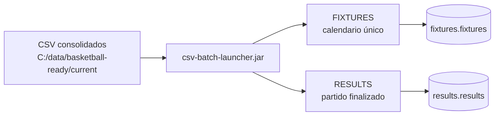
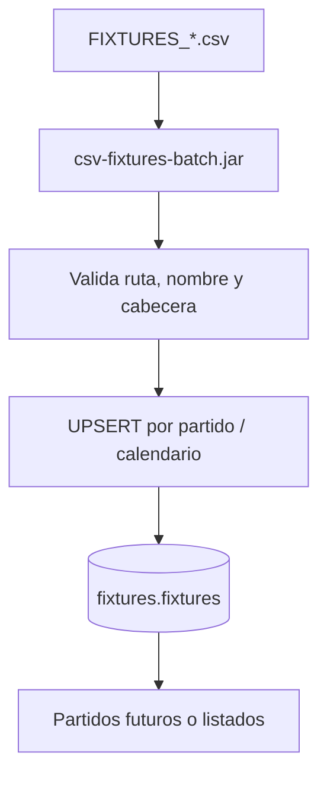
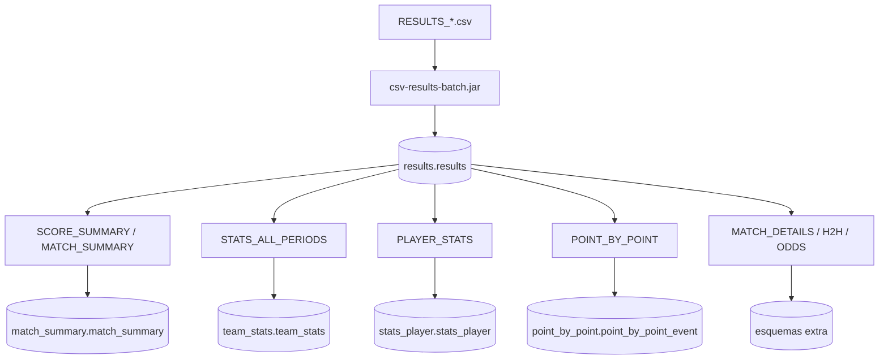
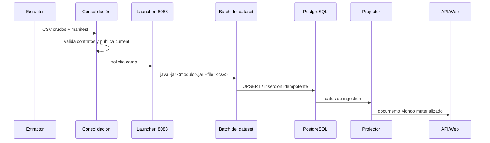
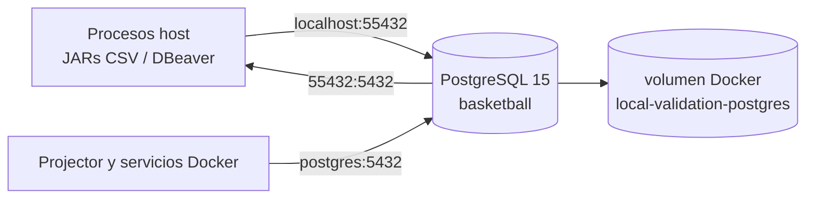
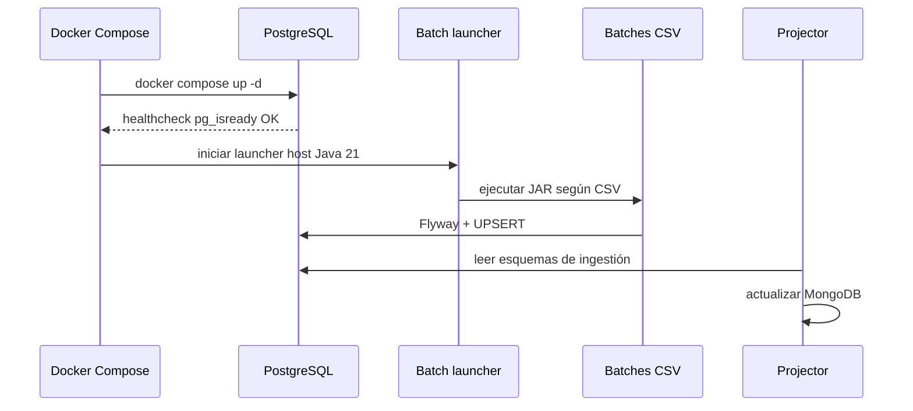

# Arquitectura y operación del reactor CSV

¿Es tu primera vez en el proyecto? Empieza por [START_HERE.md](START_HERE.md); este documento es la referencia técnica detallada.

## Idea central

El sistema tiene **dos ramas de negocio independientes**:

1. **FIXTURES** es la fuente única de calendario. Puede contener un partido no jugado y no depende de que exista resultado.
2. **RESULTS** representa un partido terminado. Desde él cuelgan resumen, estadísticas de equipo, jugadores y jugada a jugada.

Ambas ramas comparten `match_id` cuando describen el mismo encuentro, pero no se derivan una de otra.



## Rama FIXTURES: calendario único



`FIXTURES` no espera a `RESULTS`. Sirve para crear y actualizar el calendario con equipos y fecha/hora previstas.

| CSV | Campos canónicos | Tabla |
|---|---|---|
| `FIXTURES_*.csv` | `match_id,event_time,home_team,away_team,event_datetime` | `fixtures.fixtures` |

Formato histórico aceptado: `matchId,eventTime,homeTeam,awayTeam`.

| Campo | Uso |
|---|---|
| `match_id` | Identificador del partido programado. |
| `event_time`, `event_datetime` | Hora y fecha/hora previstas. |
| `home_team`, `away_team` | Equipos local y visitante. |

## Rama RESULTS: partido finalizado



El launcher respeta el orden de publicación global `RESULTS → FIXTURES → SCORE_SUMMARY → STATS_ALL_PERIODS → PLAYER_STATS → POINT_BY_POINT`; ese orden es operativo. No expresa una dependencia de datos desde `RESULTS` hacia `FIXTURES`.

### 1. RESULTS → `results.results`

Nombre: `RESULTS_<timestamp>_<country>_<competition>.csv`.

```text
matchId,eventTime,eventDatetime,homeTeam,awayTeam,homeScore,awayScore,
home_score1,home_score2,home_score3,home_score4,home_score5,
away_score1,away_score2,away_score3,away_score4,away_score5
```

| Grupo | Campos | Función |
|---|---|---|
| Identidad | `matchId` | Clave del partido. |
| Contexto | `eventTime`, `eventDatetime`, `homeTeam`, `awayTeam` | Fecha/hora y equipos. |
| Total | `homeScore`, `awayScore` | Marcador final. |
| Parciales | `home_score1..5`, `away_score1..5` | Q1–Q4 y posible prórroga. |

Los parciales que usa la API son estos campos. Se aceptan temporalmente `homeScore1..5` y `awayScore1..5`, además del formato antiguo sin `eventDatetime`.

### 2. SCORE_SUMMARY → `match_summary.match_summary`

Nombre: `SCORE_SUMMARY_<timestamp>_<matchId>.csv`.

```text
match_id,side,team,team_url,total
```

Cada `match_id` requiere dos filas: una `home` y otra `away`. `total` es el marcador final, no los parciales. También se admite `MATCH_SUMMARY_*.csv` con la cabecera histórica:

```text
date,homeName,homeImage,awayName,awayImage,resultHome,resultAway
```

### 3. STATS_ALL_PERIODS → `team_stats.team_stats`

Nombre: `STATS_ALL_PERIODS_<timestamp>_<matchId>.csv` o `stats_all_periods.csv`.

```text
match_id,period,category,metric,home_team,home_value,away_team,away_value,source_url
```

Clave de idempotencia: `(match_id, period, category, metric)`.

### 4. PLAYER_STATS → `stats_player.stats_player`

Nombre: `PLAYER_STATS_*.csv`.

```text
match_id,Player,Team,PTS,REB,AST,MIN,FGM,FGA,2PM,2PA,3PM,3PA,FTM,FTA,+/-,OR,DR,PF,ST,TO,BS,BA,TFS
```

La identidad lógica es `(match_id, Player, Team)`. Las columnas agrupan producción (`PTS`, `REB`, `AST`, `MIN`), tiro (`FGM` a `FTA`) y defensa/avanzadas (`+/-` a `TFS`).

### 5. POINT_BY_POINT → `point_by_point.point_by_point_event`

Nombre: `POINT_BY_POINT_*.csv`.

```text
match_id,record_type,quarter,sequence,home_score,away_score,
home_points_added,away_points_added,leader_side,advantage,
advantage_direction,home_is_winning,away_is_winning
```

La clave es `(match_id, quarter, sequence)`. El marcador de cada evento permite contrastar los parciales de `RESULTS`.

### 6. Datos complementarios → `csv-extra-importer-batch.jar`

| Archivo | Campos obligatorios | Tabla |
|---|---|---|
| `MATCH_DETAILS_*.csv` | `view,record_type,label,value,link_url,source_url` | `match_details.match_details` |
| `H2H_*.csv` | `match_id,section,date,competition,home_team,away_team,note,home_score,away_score,result_for_section_team,source_url` | `h2h.h2h` |
| `ODDS_*` | `match_id,market,period,bookmaker,bookmaker_id,line,home_line,away_line,home_odds,draw_odds,away_odds,over_odds,under_odds,raw_text,source_url` | `odds.odds` |

En `MATCH_DETAILS`, el importador resuelve el partido desde `source_url` (`mid=`) o desde el nombre del archivo. Las filas usan hash para evitar duplicados.

## Flujo técnico completo



## Inventario de módulos

| Módulo | JAR | Responsabilidad |
|---|---|---|
| `csv-batch-core` | `csv-batch-core-0.1.0.jar` | Contratos y orden canónico. |
| `results` | `csv-results-batch.jar` | Resultado final y parciales. |
| `fixtures` | `csv-fixtures-batch.jar` | Calendario independiente. |
| `match-summary` | `csv-stats-match-batch.jar` | Resumen visual y totales. |
| `team-stats` | `csv-team-stats-batch.jar` | Métricas de equipo. |
| `stats-player` | `csv-stats-player-batch.jar` | Rendimiento individual. |
| `point-by-point` | `csv-point-by-point-batch.jar` | Eventos cronológicos. |
| `extra-importer` | `csv-extra-importer-batch.jar` | Detalles, H2H y cuotas. |
| `launcher` | `csv-batch-launcher.jar` | Clasificación, cola y proceso Java. |

## PostgreSQL y Docker

PostgreSQL es un servicio del stack de [`local-validation/docker-compose.yml`](../local-validation/docker-compose.yml), no un proceso instalado manualmente en Windows.



### Arranque del stack

Desde `C:\Develop\basketball\local-validation`, arranca el stack completo:

```powershell
docker compose up -d
docker compose ps
```

No uses `docker compose down -v` para un apagado normal: `-v` borra los volúmenes y, por tanto, los datos persistidos. Para detenerlo sin borrar datos:

```powershell
docker compose stop
```

El servicio `postgres` usa la imagen `postgres:15-alpine`, expone el puerto host `55432` al puerto interno `5432`, y guarda sus datos en el volumen `local-validation-postgres` (o el valor de `LOCAL_VALIDATION_POSTGRES_VOLUME`). El healthcheck emplea `pg_isready`.

Comprueba su disponibilidad:

```powershell
docker compose ps postgres
docker compose exec postgres psql -U test -d basketball -c "SELECT current_database(), current_user;"
```

### Conexión desde procesos host

Los JAR ejecutados en Windows usan siempre:

```text
DB_URL=jdbc:postgresql://localhost:55432/basketball
DB_USER=test
DB_PASS=test
DB_SCHEMA=<schema del batch>
CSV_ALLOWED_ROOT=C:\data\basketball-ready
```

Ejemplo de consulta desde PowerShell sin instalar `psql` en el host:

```powershell
docker compose exec postgres psql -U test -d basketball -c "SELECT count(*) FROM results.results;"
```

### Conexión desde contenedores

Los servicios Docker nunca usan `localhost` para PostgreSQL. En su red Docker usan:

```text
jdbc:postgresql://postgres:5432/basketball
DB_USER=test
DB_PASS=test
```

El esquema se selecciona por `currentSchema=<schema>` en la URL o por `DB_SCHEMA` y el `search_path` de cada batch.

### DBeaver

| Propiedad | Valor |
|---|---|
| Host | `localhost` |
| Puerto | `55432` |
| Base de datos | `basketball` |
| Usuario | `test` |
| Contraseña | `test` |

Después de conectar, selecciona el esquema que corresponda: `fixtures`, `results`, `match_summary`, `team_stats`, `stats_player`, `point_by_point`, `match_details`, `h2h` u `odds`.

### Esquemas, propietario y migraciones

| Esquema | Propietario de datos | Batch |
|---|---|---|
| `fixtures` | Calendario único | `csv-fixtures-batch.jar` |
| `results` | Resultado final y parciales | `csv-results-batch.jar` |
| `match_summary` | Resumen y totales | `csv-stats-match-batch.jar` |
| `team_stats` | Estadísticas por equipo/periodo | `csv-team-stats-batch.jar` |
| `stats_player` | Rendimiento individual | `csv-stats-player-batch.jar` |
| `point_by_point` | Secuencia de acciones | `csv-point-by-point-batch.jar` |
| `match_details`, `h2h`, `odds` | Información complementaria | `csv-extra-importer-batch.jar` |

Flyway se ejecuta al arrancar cada batch y crea/migra únicamente su esquema. Todos los esquemas viven en la misma base `basketball`; no se crean bases separadas por dataset.

### Secuencia recomendada de operación



## Construcción, operación y validación

```powershell
$env:JAVA_HOME='C:\Program Files\Eclipse Adoptium\jdk-21.0.12.101-hotspot'
mvn -f C:\Develop\basketball\csv-extra-batch\pom.xml clean verify
```

Variables: `DB_URL=jdbc:postgresql://localhost:55432/basketball`, `DB_USER=test`, `DB_PASS=test`, `DB_SCHEMA=<schema>` y `CSV_ALLOWED_ROOT=C:\data\basketball-ready`.

Para ejecutar una jornada usa, por este orden, `validate_competition_run`, `consolidate_competition`, `start_batch_launcher` y `run_batch_ingestion` mediante `basketball_operations`.

Validación por partido:

```sql
SELECT r.match_id,
       EXISTS (SELECT 1 FROM fixtures.fixtures f WHERE f.match_id=r.match_id) AS fixture,
       EXISTS (SELECT 1 FROM match_summary.match_summary m WHERE m.match_id=r.match_id) AS summary,
       (SELECT count(*) FROM team_stats.team_stats t WHERE t.match_id=r.match_id) AS team_stats,
       (SELECT count(*) FROM stats_player.stats_player p WHERE p.match_id=r.match_id) AS players,
       (SELECT count(*) FROM point_by_point.point_by_point_event e WHERE e.match_id=r.match_id) AS pbp_events
FROM results.results r WHERE r.match_id='<MATCH_ID>';
```

Una carga está completa cuando la cola indica `COMPLETED`, PostgreSQL contiene las filas esperadas según los CSV no vacíos, los parciales cuadran y la API devuelve `homePeriods` y `awayPeriods`.
