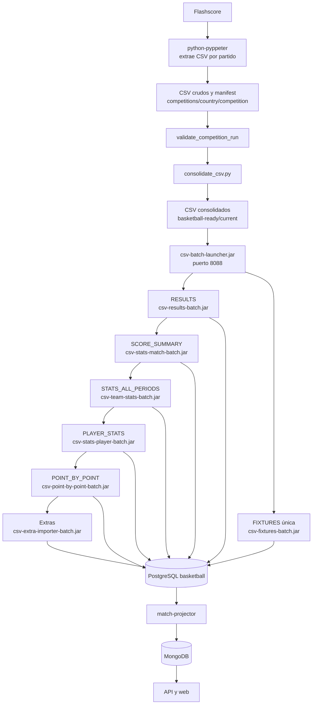

# CSV Basketball Batch Reactor

> ¿Es tu primera vez? Empieza por [START_HERE.md](START_HERE.md). Para el detalle técnico consulta [DOCUMENTATION.md](DOCUMENTATION.md). Este README conserva el inventario técnico.

Reactor Maven canónico para la ingestión de CSV de baloncesto. Todos los procesos usan Java 21 y PostgreSQL `basketball` en `localhost:55432`.

Los CSV crudos se extraen en `C:\data\basketball\competitions\<country>\<competition>`. No se cargan directamente: se validan y consolidan primero en `C:\data\basketball-ready\current`.

## Arquitectura de inicio a fin



## Módulos y JAR

| Módulo | JAR | CSV de entrada | Tabla destino |
|---|---|---|---|
| `csv-batch-core` | `csv-batch-core-0.1.0.jar` | Contratos comunes | — |
| `results` | `csv-results-batch.jar` | `RESULTS_*.csv` | `results.results` |
| `fixtures` | `csv-fixtures-batch.jar` | `FIXTURES_*.csv` | `fixtures.fixtures` |
| `match-summary` | `csv-stats-match-batch.jar` | `SCORE_SUMMARY_*.csv`, `MATCH_SUMMARY_*.csv` | `match_summary.match_summary` |
| `team-stats` | `csv-team-stats-batch.jar` | `STATS_ALL_PERIODS_*.csv` | `team_stats.team_stats` |
| `stats-player` | `csv-stats-player-batch.jar` | `PLAYER_STATS_*.csv` | `stats_player.stats_player` |
| `point-by-point` | `csv-point-by-point-batch.jar` | `POINT_BY_POINT_*.csv` | `point_by_point.point_by_point_event` |
| `extra-importer` | `csv-extra-importer-batch.jar` | detalles, H2H y cuotas | esquemas `match_details`, `h2h`, `odds` |
| `launcher` | `csv-batch-launcher.jar` | API/cola | `public.batch_launch_request` |

Todos los ejecutables se generan en `modulo/target/`.

## Orden de carga obligatorio

```text
RESULTS → FIXTURES → SCORE_SUMMARY → STATS_ALL_PERIODS → PLAYER_STATS → POINT_BY_POINT
```

`RESULTS` crea el partido finalizado y sus parciales; `SCORE_SUMMARY`, estadísticas, jugadores y PBP lo enriquecen. `FIXTURES` es una rama única e independiente: representa el calendario y puede existir aunque el partido todavía no se haya jugado. No depende de `RESULTS` ni es un detalle de este. En un flujo de partido único terminado no se publica `FIXTURES`. `MATCH_DETAILS`, `H2H` y `ODDS` son datos complementarios y se pueden cargar después.

## Contratos de CSV

Las cabeceras son la primera fila y se validan antes de insertar. El valor `match_id`/`matchId` une todas las tablas.

### RESULTS → `results.results`

Nombre: `RESULTS_<timestamp>_<country>_<competition>.csv`.

```text
matchId,eventTime,eventDatetime,homeTeam,awayTeam,homeScore,awayScore,
home_score1,home_score2,home_score3,home_score4,home_score5,
away_score1,away_score2,away_score3,away_score4,away_score5
```

`homeScore` y `awayScore` son el total final. `home_score1..5` y `away_score1..5` son Q1–Q4 y posible prórroga. La API muestra los parciales desde estos campos. Se acepta temporalmente la variante camel case y el formato histórico sin `eventDatetime`.

### FIXTURES → `fixtures.fixtures`

Nombre: `FIXTURES_*.csv`.

```text
match_id,event_time,home_team,away_team,event_datetime
```

`match_id` identifica el partido programado; `event_time` y `event_datetime` son la fecha/hora; `home_team` y `away_team` los equipos. Es una fuente única de calendario, independiente de resultados. También es compatible con la cabecera histórica `matchId,eventTime,homeTeam,awayTeam`.

### SCORE_SUMMARY / MATCH_SUMMARY → `match_summary.match_summary`

Nombres: `SCORE_SUMMARY_<timestamp>_<matchId>.csv` o `MATCH_SUMMARY_<matchId>.csv`.

Formato preferido:

```text
match_id,side,team,team_url,total
```

Cada partido necesita exactamente dos filas: `side=home` y `side=away`. `total` es el marcador final; este CSV no contiene ni sustituye los parciales. Se mantiene compatibilidad con:

```text
date,homeName,homeImage,awayName,awayImage,resultHome,resultAway
```

### STATS_ALL_PERIODS → `team_stats.team_stats`

Nombre: `STATS_ALL_PERIODS_<timestamp>_<matchId>.csv` o `stats_all_periods.csv`.

```text
match_id,period,category,metric,home_team,home_value,away_team,away_value,source_url
```

`period` identifica partido completo/cuarto; `category` y `metric` la estadística; los campos `*_value` son las métricas de los equipos. La clave idempotente es `(match_id, period, category, metric)`.

### PLAYER_STATS → `stats_player.stats_player`

Nombre: `PLAYER_STATS_*.csv`.

```text
match_id,Player,Team,PTS,REB,AST,MIN,FGM,FGA,2PM,2PA,3PM,3PA,FTM,FTA,+/-,OR,DR,PF,ST,TO,BS,BA,TFS
```

`Player` y `Team` identifican el jugador dentro del partido. `PTS`, `REB`, `AST`, `MIN` son producción; `FGM..FTA` tiro; `+/-`, `OR`, `DR`, `PF`, `ST`, `TO`, `BS`, `BA`, `TFS` métricas avanzadas/defensivas. Clave: `(match_id, Player, Team)`.

### POINT_BY_POINT → `point_by_point.point_by_point_event`

Nombre: `POINT_BY_POINT_*.csv`.

```text
match_id,record_type,quarter,sequence,home_score,away_score,
home_points_added,away_points_added,leader_side,advantage,
advantage_direction,home_is_winning,away_is_winning
```

`quarter` y `sequence` ordenan la jugada. `home_score`/`away_score` son el marcador después del evento y `*_points_added` los puntos añadidos. La clave primaria es `(match_id, quarter, sequence)`.

### Datos extras → `csv-extra-importer-batch.jar`

| Archivo | Campos obligatorios | Tabla |
|---|---|---|
| `MATCH_DETAILS_*.csv` | `view,record_type,label,value,link_url,source_url` | `match_details.match_details` |
| `H2H_*.csv` | `match_id,section,date,competition,home_team,away_team,note,home_score,away_score,result_for_section_team,source_url` | `h2h.h2h` |
| `ODDS_HOME_AWAY_*`, `ODDS_1X2_*`, `ODDS_OVER_UNDER_*`, `ODDS_ASIAN_HANDICAP_*` | `match_id,market,period,bookmaker,bookmaker_id,line,home_line,away_line,home_odds,draw_odds,away_odds,over_odds,under_odds,raw_text,source_url` | `odds.odds` |

Para `MATCH_DETAILS`, el `match_id` se obtiene de `source_url` mediante `mid=` o, si falta, del nombre de archivo. Las filas se deduplican por hash.

## Compilación y ejecución

```powershell
$env:JAVA_HOME='C:\Program Files\Eclipse Adoptium\jdk-21.0.12.101-hotspot'
mvn -f C:\Develop\basketball\csv-extra-batch\pom.xml clean verify
```

Variables obligatorias:

```text
DB_URL=jdbc:postgresql://localhost:55432/basketball
DB_USER=test
DB_PASS=test
DB_SCHEMA=<results|fixtures|match_summary|team_stats|stats_player|point_by_point>
CSV_ALLOWED_ROOT=C:\data\basketball-ready
```

El launcher escucha en `http://localhost:8088` y usa `C:\data\basketball-ready\current`. Para operación normal usa `basketball_operations`: `validate_competition_run`, `consolidate_competition`, `start_batch_launcher` y `run_batch_ingestion`.

## Validación end-to-end

1. Revisa que cada entrada de `public.batch_launch_request` quede en `COMPLETED` con `exit_code = 0`.
2. Comprueba que `results.results` tenga el partido terminado y que las tablas de detalle tengan filas si el CSV correspondiente no estaba vacío.
3. Compara parciales de `results.results` con `score_period` o los cierres de PBP. Si el CSV los tiene pero PostgreSQL no, ejecuta `backfill_results_quarters.py`.
4. Espera al projector y confirma `result.homePeriods` y `result.awayPeriods` en la API.

```sql
SELECT r.match_id,
       EXISTS (SELECT 1 FROM fixtures.fixtures f WHERE f.match_id=r.match_id) AS fixture,
       EXISTS (SELECT 1 FROM match_summary.match_summary m WHERE m.match_id=r.match_id) AS summary,
       (SELECT count(*) FROM team_stats.team_stats t WHERE t.match_id=r.match_id) AS team_stats,
       (SELECT count(*) FROM stats_player.stats_player p WHERE p.match_id=r.match_id) AS players,
       (SELECT count(*) FROM point_by_point.point_by_point_event b WHERE b.match_id=r.match_id) AS pbp_events
FROM results.results r WHERE r.match_id='<MATCH_ID>';
```

## Diagnóstico

| Síntoma | Comprobación |
|---|---|
| Batch `FAILED` | Nombre de archivo, cabecera, Java 21 y `CSV_ALLOWED_ROOT`. |
| Faltan parciales | `results.results.home_score1..5` y `away_score1..5`; nunca `SCORE_SUMMARY`. |
| PostgreSQL correcto pero web antigua | Projector, MongoDB y caché de API/web. |
| Sin detalles | El dataset puede no estar publicado por Flashscore o estar vacío; comprueba el CSV consolidado. |

Los importadores usan restricción de ruta, checksum/hash y UPSERT o claves únicas; reprocesar el mismo CSV es idempotente y no crea duplicados.
