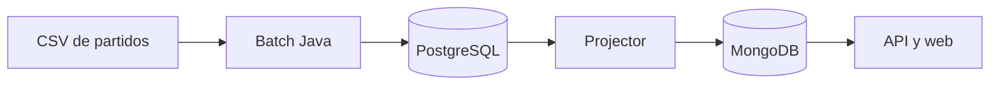

# Empieza aquí: cargar datos de baloncesto sin conocer el proyecto

Esta guía enseña el camino completo con palabras sencillas. No necesitas conocer Java, Docker, PostgreSQL ni Flashscore para seguir los pasos.

## Qué hace el proyecto

El proyecto obtiene información de partidos de baloncesto en archivos CSV y la muestra en una aplicación web.



Hay dos tipos principales de información:

| Tipo | Ejemplo | Para qué sirve |
|---|---|---|
| `FIXTURES` | Un partido de mañana | Calendario: quién juega y cuándo. |
| `RESULTS` | Un partido ya terminado | Marcador final y parciales por cuarto. |

`FIXTURES` es una rama independiente: no necesita un resultado. A partir de `RESULTS` se añaden resumen, estadísticas, jugadores y jugadas.

## Palabras importantes

| Palabra | Significado sencillo |
|---|---|
| CSV | Archivo de texto parecido a una tabla de Excel. |
| Batch | Programa Java que lee un CSV y guarda sus filas en la base de datos. |
| Launcher | Programa que detecta qué batch corresponde a cada CSV y lo ejecuta. |
| PostgreSQL | Base de datos donde se guardan los datos de carga. |
| Schema | Carpeta lógica dentro de PostgreSQL; separa resultados, calendario, jugadores, etc. |
| `match_id` | Identificador único que une los datos del mismo partido. |
| Projector | Programa que copia los datos de PostgreSQL al formato que lee la web. |
| CSV consolidado | CSV preparado y validado para cargar; no es el CSV crudo del extractor. |

## Antes de empezar

Necesitas:

1. Docker Desktop abierto y funcionando.
2. Java 21 instalado en `C:\Program Files\Eclipse Adoptium\jdk-21.0.12.101-hotspot`.
3. Maven disponible en PowerShell.
4. El workspace en `C:\Develop\basketball`.

Compruébalo:

```powershell
docker version
& 'C:\Program Files\Eclipse Adoptium\jdk-21.0.12.101-hotspot\bin\java.exe' -version
mvn -version
```

## Inicio rápido: ver el sistema funcionando

### 1. Arranca Docker

Abre PowerShell y ejecuta:

```powershell
cd C:\Develop\basketball\local-validation
docker compose up -d
docker compose ps
```

Espera a que `postgres`, `mongo`, `basketball-match-projector`, `basketball-match-api` y `basketball-match-web` estén activos. La web queda en `http://localhost:8083` y la API en `http://localhost:8082`.

No ejecutes `docker compose down -v`: borra el volumen de PostgreSQL y todos los datos locales.

### 2. Compila los batch

```powershell
$env:JAVA_HOME='C:\Program Files\Eclipse Adoptium\jdk-21.0.12.101-hotspot'
mvn -f C:\Develop\basketball\csv-extra-batch\pom.xml clean verify
```

El resultado correcto es `BUILD SUCCESS`. Los programas creados se llaman, por ejemplo, `csv-results-batch.jar` y `csv-fixtures-batch.jar`.

### 3. Comprueba PostgreSQL

No hace falta instalar PostgreSQL en Windows; Docker ya lo inició.

```powershell
docker compose exec postgres psql -U test -d basketball -c "SELECT current_database(), current_user;"
```

La salida debe indicar `basketball` y `test`.

### 4. Usa una extracción ya preparada

Los CSV que puede cargar el sistema viven solamente en:

```text
C:\data\basketball-ready\current
```

No copies manualmente CSV crudos ahí. El flujo correcto es:

```text
extracción → validación → consolidación → carga batch
```

Desde las herramientas `basketball_operations`, ejecuta en este orden:

1. `validate_competition_run(country, competition)`
2. `consolidate_competition(country, competition)`
3. `start_batch_launcher()`
4. `run_batch_ingestion()`

El launcher decide qué JAR ejecutar a partir del nombre del CSV.

### 5. Confirma que se cargó

```powershell
docker compose exec postgres psql -U test -d basketball -c "SELECT batch_type, status, exit_code FROM public.batch_launch_request ORDER BY created_at DESC LIMIT 20;"
```

Los registros correctos muestran `status = COMPLETED` y `exit_code = 0`.

Después abre `http://localhost:8083`. Puede tardar aproximadamente un minuto en verse un cambio porque el projector actualiza MongoDB periódicamente.

## Conectar con DBeaver

Crea una conexión PostgreSQL con estos valores:

| Campo | Valor |
|---|---|
| Host | `localhost` |
| Puerto | `55432` |
| Database | `basketball` |
| Usuario | `test` |
| Contraseña | `test` |

Los datos no están todos en una sola tabla. En DBeaver abre el esquema adecuado:

| Si buscas… | Esquema y tabla |
|---|---|
| Calendario | `fixtures.fixtures` |
| Resultado y parciales | `results.results` |
| Resumen de marcador | `match_summary.match_summary` |
| Estadísticas de equipo | `team_stats.team_stats` |
| Estadísticas de jugadores | `stats_player.stats_player` |
| Jugada a jugada | `point_by_point.point_by_point_event` |

## Ejemplo sencillo: comprobar un partido

Cuando conozcas un `match_id`, sustitúyelo en esta consulta:

```sql
SELECT r.match_id, r.home_team, r.away_team, r.home_score, r.away_score,
       r.home_score1, r.home_score2, r.home_score3, r.home_score4,
       r.away_score1, r.away_score2, r.away_score3, r.away_score4,
       (SELECT count(*) FROM team_stats.team_stats t WHERE t.match_id = r.match_id) AS stats_equipo,
       (SELECT count(*) FROM stats_player.stats_player p WHERE p.match_id = r.match_id) AS jugadores,
       (SELECT count(*) FROM point_by_point.point_by_point_event e WHERE e.match_id = r.match_id) AS eventos
FROM results.results r
WHERE r.match_id = '<MATCH_ID>';
```

Si el CSV de estadísticas o PBP estaba vacío porque Flashscore no publicó esa información, su contador puede ser cero. El resultado principal y los parciales deben venir de `RESULTS`.

## Qué no hacer

- No uses `localhost:5432` desde Windows: el puerto correcto es `55432`.
- No uses `postgres` como usuario ni otra base de datos: usa `test` y `basketball`.
- No cargues CSV crudos desde `C:\data\basketball\competitions`; antes deben consolidarse.
- No modifiques los CSV para arreglar parciales. Usa el proceso de reconciliación de parciales.
- No ejecutes `docker compose down -v` salvo que quieras borrar expresamente los datos.
- No ejecutes Java 17 por accidente: todos los batch requieren Java 21.
- No supongas que la web se actualiza al instante: PostgreSQL pasa primero por el projector y MongoDB.

## Si algo falla

| Problema | Primer sitio a comprobar |
|---|---|
| Docker no arranca | `docker compose ps` desde `local-validation`. |
| Un batch falla | Estado y error en `public.batch_launch_request`; nombre y cabecera del CSV. |
| No conecta a base de datos | Host `localhost`, puerto `55432`, base `basketball`, usuario `test`. |
| Faltan parciales | Tabla `results.results`, columnas `home_score1..5` y `away_score1..5`. |
| PostgreSQL tiene datos pero la web no | Projector, MongoDB y espera de la reconciliación. |

Cuando necesites el detalle técnico de cada archivo, tabla y diagrama, continúa en [DOCUMENTATION.md](DOCUMENTATION.md).
